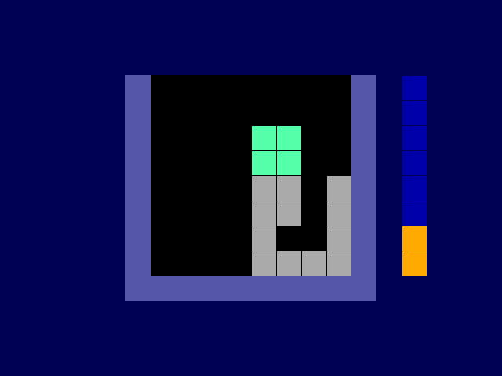

   

# Blocos: 8x8 falling-block game on VGA

A falling-block puzzle that runs entirely in hardware on one
[Tiny Tapeout](https://tinytapeout.com) tile (SKY130): an 8x8 bit board in
D flip-flops, a game state machine and a VGA output generated pixel by pixel,
with no CPU and no framebuffer.



Full description, pinout and how to play: [docs/info.md](docs/info.md).

| Pins | Use |
|---|---|
| `ui[0..3]` | LEFT, RIGHT, ROTATE, DOWN buttons (active high) |
| `uo[0..7]` | TinyVGA PMOD, 640x480 @ 60 Hz (25.175 MHz clock) |
| `uio[0..7]` | score (lines cleared) in binary |

## Repository

| Path | Contents |
|---|---|
| `src/` | Verilog: `tt_um_duarte_diamantino_blocos.v` (top, video), `game.v`, `pieces.v`, `vga_sync.v` |
| `test/` | cocotb tests run by the CI on the RTL and on the gate-level netlist (pins only) |
| `sim/` | faster Icarus testbench for the game rules (forces a short frame period) and VGA frame capture to `frame.png` |
| `synth/` | Yosys synthesis against `sky130_fd_sc_hd` with area per module |

## Running locally

```sh
cd test && make                 # cocotb tests (cocotb 2.1 + Icarus Verilog)
bash sim/run_sim.sh             # game rule tests + sim/frame.png
bash synth/synth.sh             # area: 9 458 um2, 52.7 % of a 1x1 tile before place & route
```

`sim/run_sim.sh` and `synth/synth.sh` expect the OSS CAD Suite in
`~/oss-cad-suite` and the SKY130 liberty file in `~/pdk`.
